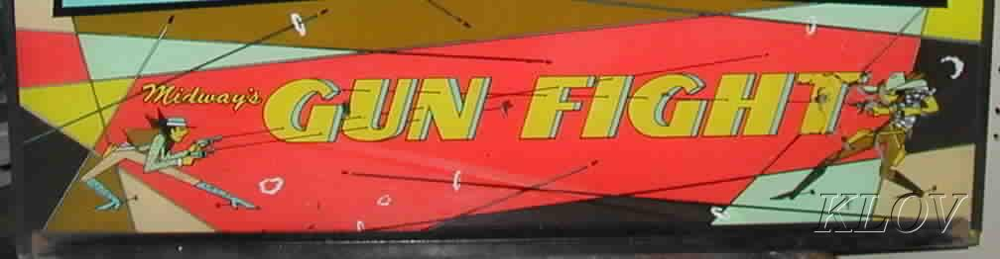
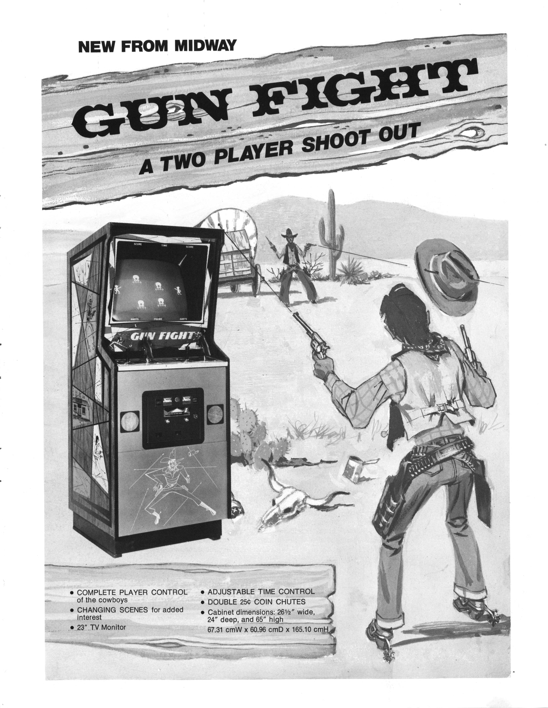
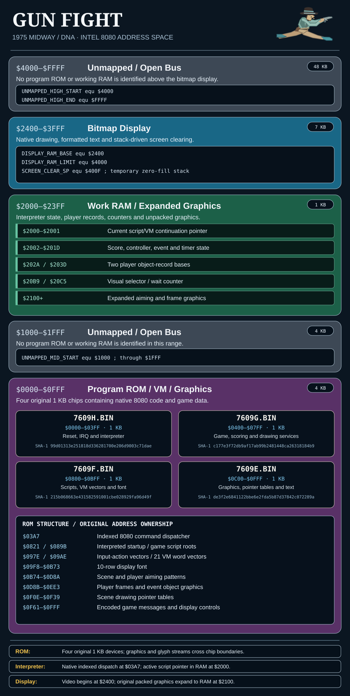

# Gun Fight

Gun Fight (1975) is Midway's two-player western shoot-out, developed by Dave Nutting Associates on an Intel 8080 arcade platform. This project reconstructs the four original 1 KB ROMs as readable, rebuildable 8080 assembly and documents the game's interpreter, hardware interfaces, gameplay, graphics, and data.



Gun Fight was among the first commercially released microprocessor-based video games. The two players move and aim their cowboys, fire a limited supply of shots, and compete over successive timed duels. Different screens introduce obstacles into the line of fire.



## Project layout

The maintained reconstruction is [`src/gunfight.asm`](src/gunfight.asm); [`build.sh`](build.sh) and [`build.bat`](build.bat) assemble it with the bundled zmac 1.3. The four original devices are preserved in [`roms/original/gunfight.zip`](roms/original/gunfight.zip). Recovered interpreter definitions, script traces, hardware notes, and research reports are in [`docs/`](docs/). The standalone Python scripts under [`tools/`](tools/) are RE aids; the normal ROM build does not invoke them.

## Build

Linux:

```sh
./build.sh
```

Windows 10/11:

```bat
build.bat
```

Both scripts assemble `src/gunfight.asm` with **zmac 1.3**, create a 4 KB program image, split it into the original four 1 KB devices, verify their SHA-1 identities, and produce `roms/build/gunfight.zip` for MAME. Any ROM mismatch stops the build. Human-edited source is not regenerated during a build.

Generated files:

```text
roms/build/gunfight.bin
roms/build/7609h.bin
roms/build/7609g.bin
roms/build/7609f.bin
roms/build/7609e.bin
roms/build/gunfight.zip
src/zout/gunfight.lst
```

## Run in MAME

```sh
mame gunfight -window -skip_gameinfo -rompath roms/build
```

## ROM organization

Four consecutive 1 KB devices form the $0000–$0FFF executable image.

| Device | ROM addresses | SHA-1 |
| --- | --- | --- |
| `7609h.bin` | `$0000–$03FF` | `99d01313e251818d336281700e206d9003c71dae` |
| `7609g.bin` | `$0400–$07FF` | `c177e3f72db9af17ab99b2481448ca26318184b9` |
| `7609f.bin` | `$0800–$0BFF` | `215b068663e431582591001cbe028929fa96d49f` |
| `7609e.bin` | `$0C00–$0FFF` | `de3f2e6841122bbe6e2fda5b87d37842c072289a` |

The memory map identifies original ROM regions separately from working RAM, bitmap addresses, and interpreter ownership.



## Indexed game-command interpreter

Gun Fight contains an early indexed VM at `$03A7`. Its script pointer is stored at RAM `$2000`, and its native command vector table starts at ROM `$09AE`. There are **21 native command handlers** (tokens `$00–$14`), with separate native input-action and event-script pointer tables.

The main program starts interpreting at `$0821`; gameplay initialization also uses `$089B`. Commands carry inline operands: for example, `$05` copies 15 literal bytes into a game-object record, and `$06` copies nine bytes. Other handlers draw score text, fill video regions, initialize objects, wait on timers, or redirect game-script execution.

```asm
; Game setup — interpreted command stream at $089B
DB $04                     ; clear display
DB $13                     ; update scores
DB $0F                     ; expand packed graphics
DB $0A                     ; select display sequence
DB $01,$09                 ; draw formatted data
DW $0FAF,$2E0C             ; source and bitmap destination
```

The complete reconstructed commands and native effects are in [8080 word semantics](docs/8080-WORD-SEMANTICS.md), [decoded game scripts](docs/decoded-scripts.md), [native implementations](docs/NATIVE-WORD-IMPLEMENTATIONS.md), and [vector ownership](docs/ROM-VECTOR-OWNERSHIP.md).

## Native code and input

The Intel 8080 reset path initializes game state and enters the VM. Input handling samples ports `$00` and `$01`; a 24-entry table at `$097E` selects native movement, aim and firing actions. The two firing paths at `$04B0` and `$0517` share the shot-state service at `$04FA`. Score conversion and formatted display are implemented by separate native services.

The source carries function headings, descriptive labels and explanatory comments at meaningful operations. The original ROM is the behavioral and byte-level reference. See [native implementation analysis](docs/NATIVE-WORD-IMPLEMENTATIONS.md) and [interpreter dispatch](docs/interpreter.md).

## Graphics and game data

Display-memory writes begin at `$2400`. The ROM contains character shapes, bit patterns, graphics tables, and object descriptors. The score/text renderer at `$05FB` uses ten scanline bytes per glyph with a 32-byte screen-line stride; the packed graphics expander at `$07AB` writes unpacked data into RAM beginning at `$2100`.

The assembly keeps the original data inline. [Data classification](docs/DB-PROVENANCE.md) distinguishes script operands, native code, graphics, tables, and bytes whose specific function remains under analysis.

## Research and references

- [Memory map and device assignments](docs/memory-map.md)
- [Command semantics and execution notes](docs/8080-WORD-SEMANTICS.md)
- [Original ROM pointer ownership](docs/ROM-VECTOR-OWNERSHIP.md)
- [Original documentation](docs/GunFight.pdf) and [supplementary manual](docs/gunfight_2.pdf)
- [Reverse-engineering sprint plan](docs/SPRINT-PLAN.md)

The engineering requirements are maintained separately in [ENGINEERING-RULES.md](ENGINEERING-RULES.md), with remaining tasks in [technical debt](docs/TECHNICAL-DEBT.md).
