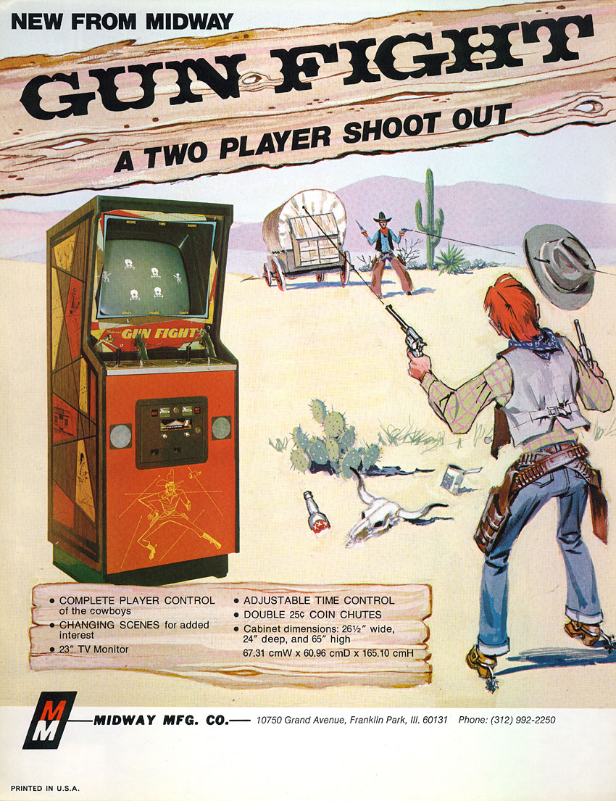
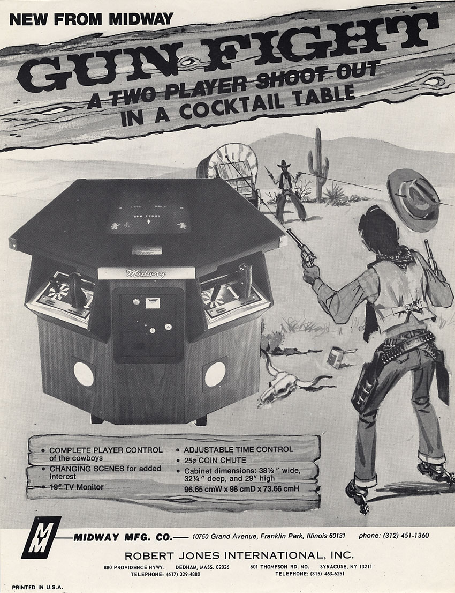

# Gun Fight (1975)


**Gun Fight** is Midway's 1975 two-player western arcade game, developed on Dave Nutting Associates' Intel 8080-based video platform. This repository reconstructs the program from its four original 1 KB ROM devices, maintains readable 8080 assembly, and documents the game's native routines and early indexed game-command interpreter.

The original ROM is the authority. Descriptive symbols and annotations are reverse-engineered names, not purported surviving DNA source identifiers. Assembly changes must reproduce the original 4,096 bytes exactly.

## The game



Two players control cowboys who move, aim, and fire across the playfield. The program handles controls, projectiles, collisions, score, timing, and bitmap graphics through a combination of native Intel 8080 routines and compact interpreted command streams.



## How the program works

The CPU begins at the reset vector, initializes game state and the video display, then starts the primary command stream at `$0821`. An alternate script begins at `$089B`. The native dispatcher at `$03A7` reads a command through the script pointer in RAM `$2000`, looks up its handler in the table at `$09AE`, and transfers control to native 8080 code.

There are **21 established native command handlers** (tokens `$00–$14`). Subsequent pairs in ROM belong to event-script selection, not nine additional VM words. A separate table at `$097E` supplies **24 native input-action pointers**.

The main script organizes game startup and display work; native input actions control the cowboys, shots, status, and event transitions. The original command streams contain inline operands and object data. They must not be interpreted as uninterrupted 8080 instructions.


The detailed analysis lives in [command semantics](docs/8080-WORD-SEMANTICS.md), [native implementations](docs/NATIVE-WORD-IMPLEMENTATIONS.md), [decoded command scripts](docs/decoded-scripts.md), and [ROM vector ownership](docs/ROM-VECTOR-OWNERSHIP.md).

## ROM and memory organization

Four 1 KB ROM devices form the original 4 KB program image:

- `$0000–$03FF`: `7609h.bin` — reset and interrupt paths, native update services.
- `$0400–$07FF`: `7609g.bin` — controller and game operations, display and object services.
- `$0800–$0BFF`: `7609f.bin` — native VM words, startup and event scripts, vector tables.
- `$0C00–$0FFF`: `7609e.bin` — packed graphic, text and other game data.

The VM script cursor resides at `$2000`; game state and object records occupy the `$20xx` region, with graphics expansion into RAM beginning at `$2100`. Bitmap display operations use addresses from `$2400` upward. For the original chip hashes and address interpretations, see [memory-map notes](docs/memory-map.md).

## Assembly and graphics

`src/gunfight.asm` is the maintained, buildable reconstruction. Meaningful native routines use descriptive labels and function headers. Interpreted commands are emitted as `DB` tokens, `DW` pointers, and grouped literal payloads. Data remains data unless references and machine behavior establish an executable path.

The graphics regions contain packed bitmap and character data used by the rendering routines. Their display formats and sprite boundaries must be recovered from the native decoding paths; the source is progressively annotated with those findings rather than inventing sprite definitions.

See [data classification](docs/DB-PROVENANCE.md) and the [engineering rules](ENGINEERING-RULES.md).

## Build

Like the Sea Wolf / Missile reconstruction, the ordinary build uses the bundled **zmac 1.3** and native OS commands. It **does not run Python** or regenerate the maintained assembly.

Linux (from the repository root):

```sh
./build.sh
```

Windows 10/11:

```bat
build.bat
```

Both scripts:

1. Assemble `src/gunfight.asm` with `tools/zmac` or `tools/zmac.exe` into a 4 KB image and assembler listing.
2. Split the image into four original device files and verify each against its original SHA-1 digest. Any mismatch fails the build.
3. Package the verified device files into `roms/build/gunfight.zip` for MAME.

Outputs: `roms/build/gunfight.bin`, `roms/build/7609h.bin`, `7609g.bin`, `7609f.bin`, `7609e.bin`, `roms/build/gunfight.zip`, and `src/zout/gunfight.lst`.

Run with a compatible MAME installation:

```sh
mame gunfight -window -skip_gameinfo -rompath roms/build
```

## Reverse-engineering tools

The Python scripts in `tools/` are **separate research utilities**, not build dependencies. `recover_8080.py` reconstructs instruction paths from the ROM; `audit_words.py` analyzes the interpreted stream; `interpreter_lineage.py` inventories vectors; `memory_map.py` generates research data; `verify_rom.py` performs additional independent analysis checks.

The research generator can regenerate a fresh disassembly and therefore overwrite human-edited source. Run it only deliberately in an RE workspace, and reconcile its findings into the maintained assembly.

## Project files

- [Maintained assembly source](src/gunfight.asm) and [Linux build](build.sh) / [Windows build](build.bat).
- [ROM interpreter](docs/interpreter.md), [word dictionary](docs/8080-WORD-SEMANTICS.md), and [decoded scripts](docs/decoded-scripts.md).
- [Memory map](docs/memory-map.md), [data provenance](docs/DB-PROVENANCE.md), and [native implementation audit](docs/NATIVE-WORD-IMPLEMENTATIONS.md).
- [Sprint plan](docs/SPRINT-PLAN.md) and [technical debt](docs/TECHNICAL-DEBT.md).

## References

The repository includes original documentation in `docs/GunFight.pdf` and `docs/gunfight_2.pdf`. The wider DNA interpreter comparison is in the [DNA TERSE Workbench runtime variants](https://github.com/lizard43/dnaTERSE-WB/blob/docs/runtime-variant-inventory-v20261107-0001/docs/TERSE-RUNTIME-VARIANTS.md).
