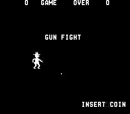
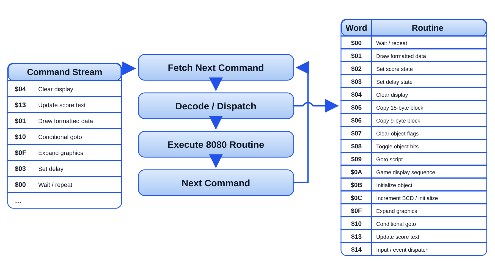

# Gun Fight

Gun Fight (1975) is Midway's two-player western shoot-out, developed by Dave Nutting Associates on an Intel 8080 arcade platform. 


Gun Fight was among the first commercially released microprocessor-based video games. The two players move and aim their cowboys, fire a limited supply of shots, and compete over successive timed duels. Different screens introduce obstacles into the line of fire.



## Build

Linux:

```sh
./build.sh
```

Windows:

```bat
build.bat
```

## Run in MAME

```sh
mame gunfight -window -skip_gameinfo -rompath roms
```

## ROM

Four consecutive 1 KB devices form the $0000–$0FFF executable image.


```text
$0000–$03FF   7609h.bin
$0400–$07FF   7609g.bin
$0800–$0BFF   7609f.bin
$0C00–$0FFF   7609e.bin
```


## Indexed game-command interpreter

Gun Fight contains an indexed VM at `$03A7`. Its script pointer is stored at RAM `$2000`, and its native command vector table starts at ROM `$09AE`. There are **21 native command handlers** (tokens `$00–$14`), with separate native input-action and event-script pointer tables.



This 1975 indexed command architecture establishes an early foundation for DNA's 8080 game-programming systems. 

Later titles retained and evolved the indexed-native-dispatch idea while changing their command vocabularies and scheduling; common architecture alone does not establish identical source or code.

The main program starts interpreting at `$0821`; gameplay initialization also uses `$089B`. 

Commands carry inline operands: for example, `$05` copies 15 literal bytes into a game-object record, and `$06` copies nine bytes. Other handlers draw score text, fill video regions, initialize objects, wait on timers, or redirect game-script execution.

```asm
; Game setup — interpreted command stream at $089B
DB $04                     ; clear display
DB $13                     ; update scores
DB $0F                     ; expand packed graphics
DB $0A                     ; select display sequence
DB $01,$09                 ; draw formatted data
DW $0FAF,$2E0C             ; source and bitmap destination
```