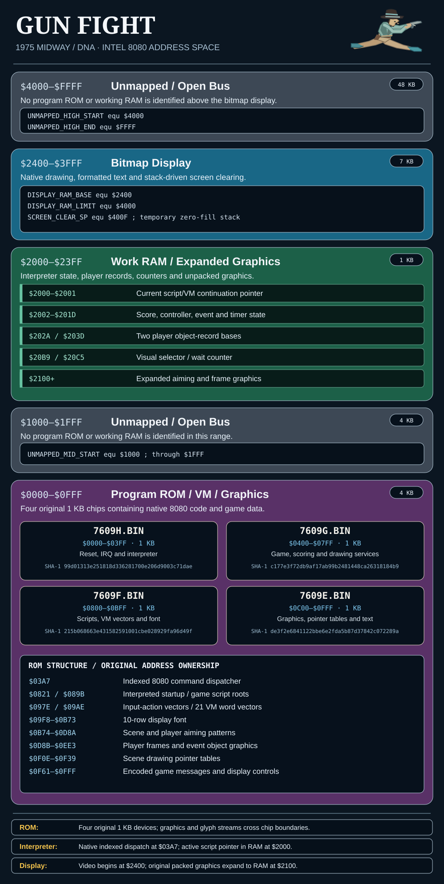

# Gun Fight — Intel 8080 ROM and memory organization

## Original program ROM

The four program ROM devices form one contiguous 4 KB image. The addresses below are CPU-visible offsets; the names and hashes identify the exact original device images.

| Device | Address range | SHA-1 |
| --- | --- | --- |
| `7609h.bin` | `$0000–$03FF` | `99d01313e251818d336281700e206d9003c71dae` |
| `7609g.bin` | `$0400–$07FF` | `c177e3f72db9af17ab99b2481448ca26318184b9` |
| `7609f.bin` | `$0800–$0BFF` | `215b068663e431582591001cbe028929fa96d49f` |
| `7609e.bin` | `$0C00–$0FFF` | `de3f2e6841122bbe6e2fda5b87d37842c072289a` |

## Interpreter and game code

- `$0000`: reset vector; sets SP=`$2400` and jumps to initialization at `$0390`.
- `$0008`, `$0010`: register-preserving interrupt vectors and video/object maintenance paths.
- `$022D`: native object/bitmap drawing with hardware port `$04` output and port `$03` readback.
- `$0359`: packed-coordinate conversion. Low three bits of E become bit-phase C; the other bits contribute to a bitmap address at `$2400`.
- `$0390`: program initialization; clears initial game bytes, clears bitmap, and enters the script at `$0821`.
- `$03A7`: indexed VM dispatcher; `$2000` is its continuation pointer, `$09AE` its 21-entry native vector table.
- `$03C9`: input and event dispatch.
- `$04B0`/`$0517`: player-one/two firing paths; share the native service at `$04FA`.
- `$05FB`: formatted character renderer; glyph data at `$09F8`, ten bytes per glyph and 32-byte output row stride.
- `$07AB`: packed-graphics expander; writes into RAM at `$2100`.
- `$0821` and `$089B`: interpreted startup and alternative game scripts.
- `$097E–$09AD`: 24-entry native input-action vector table.
- `$09AE–$09D7`: 21-entry native game-word table.
- `$09D6–$09E9`: event selection uses the last VM word entry as its first slot and nine subsequent script addresses.
- `$09F8`: ten-row font begins here; includes digit and subsequent display glyphs through `$0B73`.

## ROM artwork and text layout

The original ROM partitions are device boundaries, not semantic boundaries. In particular, the font and packed graphics cross between device `7609f.bin` and `7609e.bin`.

| ROM addresses | Recovered contents |
| --- | --- |
| `$0800–$097D` | VM handler tails and interpreted game-command scripts |
| `$097E–$09AD` | 24 native input-action vectors |
| `$09AE–$09D7` | 21 indexed game-command handlers |
| `$09D8–$09E9` | Nine event-script destination pointers (the event selector also uses the shared `$09D6` entry) |
| `$09F8–$0B73` | Ten-row display font, digit glyphs and following glyph slots |
| `$0B74–$0BC3` | Two dimensioned scene-drawing shapes, 8×22 and 16×27 |
| `$0BC4–$0D8A` | Seven 24×21 player aiming graphics, crossing the `$0C00` ROM boundary |
| `$0D8B–$0E8C` | Player frame graphics and two event-installed object patterns |
| `$0E8D–$0EE3` | Graphics terminator and special-object pattern (last two bytes shared with an unused aim-table entry) |
| `$0EE2–$0EFD` | Two linked, shared-entry player aim-pointer tables |
| `$0EFE–$0F0D` | Shared second-player pointer / shot-parameter base and seven relative XY shot pairs |
| `$0F0E–$0F39` | Native scene drawing destination/source pointer pairs |
| `$0F3A–$0F60` | Scene state and special-object initialization bytes |
| `$0F61–$0FFF` | Encoded game messages and display control values |

At `$0F61` the text begins with the *GAME OVER* message. Later entry points display *GUN FIGHT*, *INSERT COIN*, *GET READY*, *DRAW*, and other status/credit prompts. Each byte at least `$30` indexes the original 10-row glyph font; smaller values move the display position. These are encoded glyph streams, not standard ASCII strings. The code uses the `$01` VM command's glyph-count operand and a source pointer to render them.

The addresses and record roles are reconstructed from the native source and preserved ROM; no claim of exhaustive physical memory decoding is made. See [graphics formats](GRAPHICS.md) and [script semantics](8080-WORD-SEMANTICS.md).

## RAM and display

The addresses below are observed directly in original 8080 memory instructions. The complete physical decode and any additional mirrors remain a separate board-level hardware investigation.

- `$2000–$2001`: 16-bit current interpreter script address.
- `$2002–$201D`: score, timer, event selection, controller and rendering state.
- `$202A` and `$203D`: the beginning of the two player object records.
- `$20B9`: selector in interrupt-driven visual work.
- `$20C5`: countdown/repeat state for VM word `$00`.
- `$20C6`: selects alternate command stream `$089B` during dispatch.
- `$2100`: native expanded-graphics destination.
- `$2400`: display base address used in coordinate conversion and reset stack setting.
- `$400F`: temporary SP used to clear video memory by repeated pushes; normal SP restored to `$2400`.

## Input/output port use

Native code reads player input ports `$00` and `$01` (with repeated reads for stable sampling), and a separate video interaction path uses `$02`, `$03`, and `$04`. Output port `$01` is also written during firing and mode changes. Port direction and any board-specific signal names must be verified against the original schematic.

Related references: [word semantics](8080-WORD-SEMANTICS.md), [decoded scripts](decoded-scripts.md), [vector ownership](ROM-VECTOR-OWNERSHIP.md), and [original ROM data classification](DB-PROVENANCE.md).
